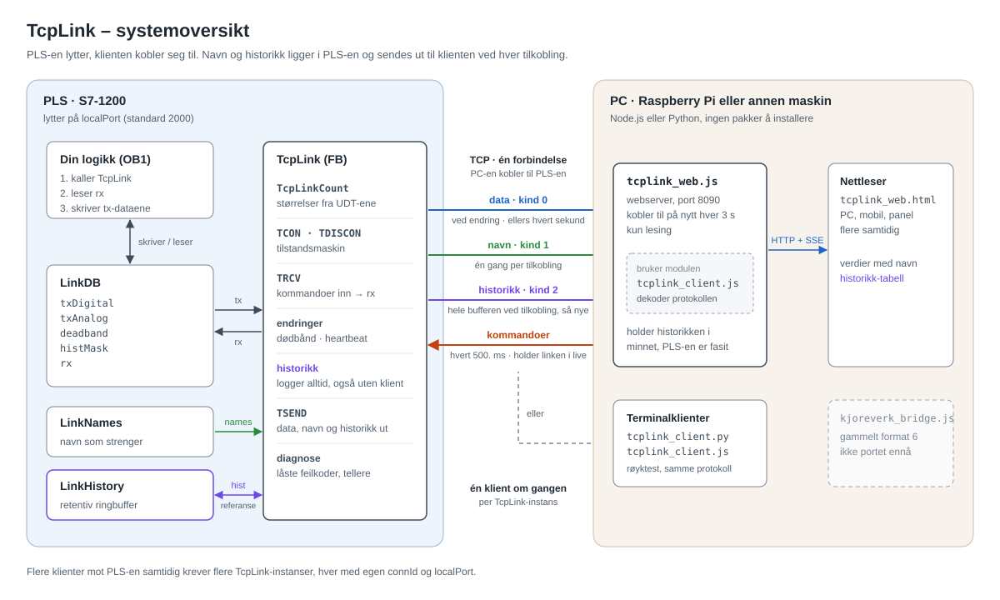
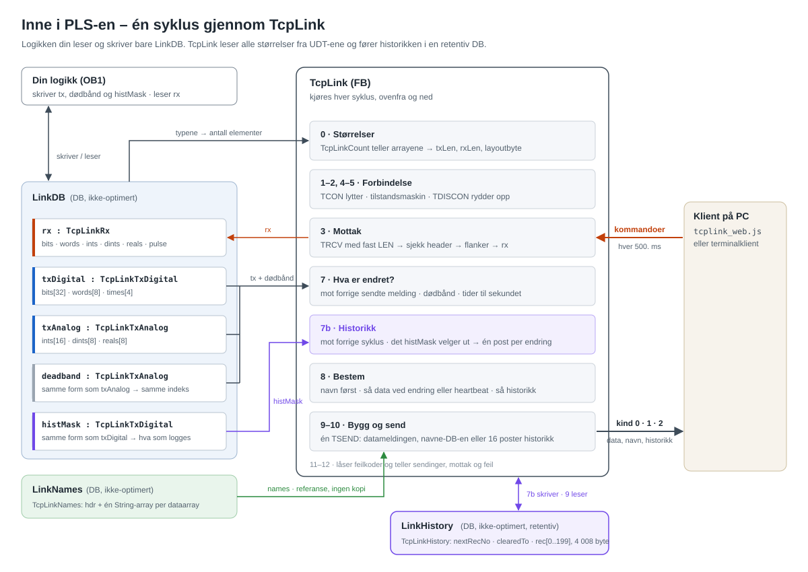
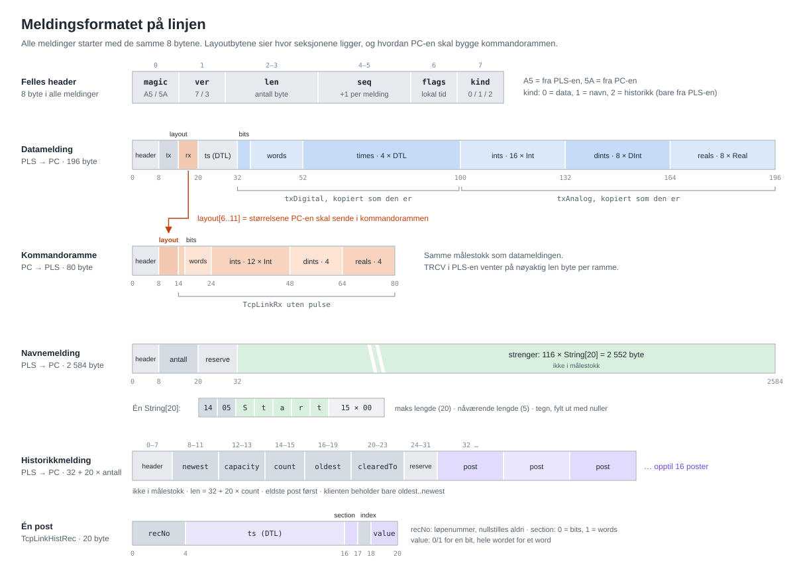
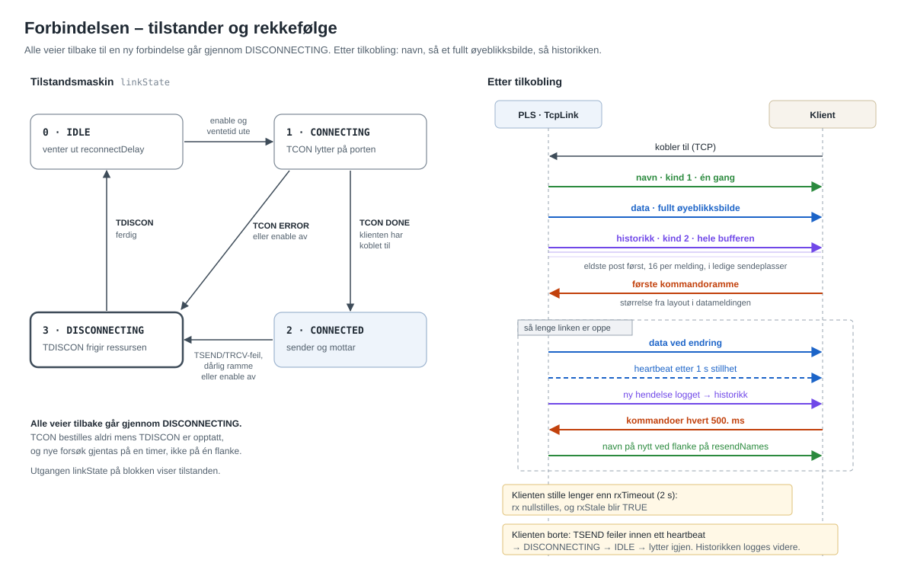
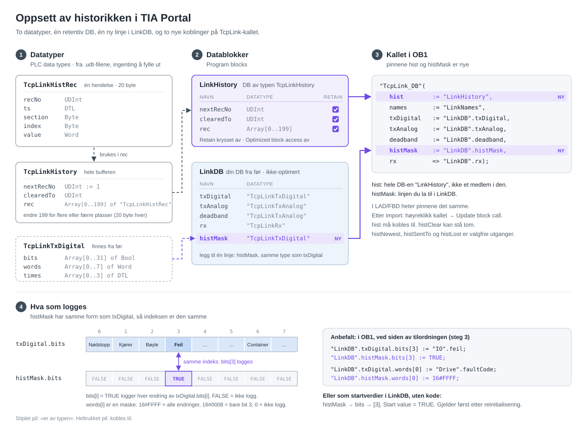

# TcpLink: generell link mellom PLS og PC

`TcpLink` er motoren fra `KjoreverkLink` med alt som er spesifikt for
kjøretøyet og frekvensomformeren tatt ut. Håndtering av forbindelsen,
sending ved endring, heartbeat, timeout på kommandoer og låsing av feil
virker på samme måte. Det som er endret, er dataene:

| Kjøreverk | TcpLink |
|---|---|
| `KjoreverkTxBits` (32 bools med navn) | `TcpLinkTxDigital`: `bits[]`, `words[]`, `times[]` |
| `KjoreverkTxValues` + `KjoreverkTxDrive` | `TcpLinkTxAnalog`: `ints[]`, `dints[]`, `reals[]` |
| `KjoreverkRxCommands` | `TcpLinkRx`: `bits[]`, `words[]`, `ints[]`, `dints[]`, `reals[]`, `pulse[]` |
| `lastDriveTime`, én fast DTL | `times[]`, så mange DTL-er du vil |
| 6 separate dødbåndinnganger | én `deadband`-inngang, av samme type som `txAnalog` |
| forbindelses-ID 1 og port 2000 kodet fast | innganger `connId`, `localPort`, så flere instanser kan kjøre |
| størrelser skrevet inn i FB-en for hånd | størrelser **lest fra UDT-ene**: endre størrelsen der og ingen andre steder |
| fast layout, klienten må tilpasses for hånd | layouten sendes i hver header, så klienten setter seg opp selv |
| navn skrevet inn under Innstillinger i klienten | navn skrevet inn i PLS-en (`TcpLinkNames`), sendt til klienten ved tilkobling |
| ingenting logges mens PC-en er av | retentiv historikk i PLS-en (`TcpLinkHistory`), hentes ved hver tilkobling |

Blokken vet **hva slags** data hver plass inneholder, aldri **hva de
betyr**. Den avgjørelsen flyttes til det ene stedet der du kaller blokken,
så de samme UDT-ene dekker alle prosjekter. Hva hver plass **heter**, ligger
i en fjerde UDT, som sendes til klienten én gang per forbindelse (§3.6).
Historikken ligger i en retentiv ringbuffer i PLS-en, og en klient som
kobler til, for eksempel en Pi som nettopp har startet, får hele bufferen
først (§3.8).

---

## Arkitekturkart

Fem kart i mappen `arkitektur/`. Fargene betyr det samme i alle:
blått er data fra PLS-en, grønt er navn, lilla er historikk, oransje er
kommandoer fra PC-en.

**Systemoversikt.** Hvem som snakker med hvem, og hvilke meldinger som går
hvilken vei.



**Inne i PLS-en.** Logikken din rører bare `LinkDB`; `TcpLink` kjører de
samme stegene hver syklus og henter størrelsene fra UDT-ene.



**Meldingsformatet.** Datameldingen og kommandorammen i samme målestokk, og
hvordan `layout[6..11]` forteller PC-en hvordan kommandorammen skal bygges.



**Forbindelsen.** Tilstandsmaskinen, og rekkefølgen på meldingene etter at
en klient har koblet til.



**Oppsett av historikken.** Datatypene, `LinkHistory`, den nye linjen
`histMask` i `LinkDB`, de to nye koblingene på kallet, og hvordan
`histMask` velger hva som logges.



---

## 1. Filer og import

Generer blokker fra kilde, i denne rekkefølgen:

1. `TcpLinkTxDigital.udt`
2. `TcpLinkTxAnalog.udt`
3. `TcpLinkRx.udt`
4. `TcpLinkNames.udt`
5. `TcpLinkHistRec.udt`
6. `TcpLinkHistory.udt` (bruker `TcpLinkHistRec`, så den må komme etter)
7. `TcpLink.scl`, som lager **to** blokker: hjelpefunksjonen (FC)
   `TcpLinkCount` og FB-en `TcpLink`
8. `LinkNames.db`: navne-DB-en din, fylt ut med kjøreverk-navnene som
   eksempel. Rediger den, eller lag din egen ut fra den.
9. `LinkHistory.db`: historikken. Sjekk at den er **retentiv** (§3.8).

`tcplink_client.py` og `tcplink_client.js` er minimale klienter for testing,
i Python og i Node (§6). `tcplink_web.js` og `tcplink_web.html` er en
sanntidsvisning i nettleseren, kun for lesing (§6.1). Mappen `arkitektur/`
har fem SVG-kart over prosjektet (se Arkitekturkart over).

FB-en må forbli **ikke-optimert**: formatet på linjen er strukturens layout.

**Tegnsett.** Kildefilene til TIA (`.scl`, `.udt`, `.db`) er lagret som
**UTF-8 med BOM**, slik TIA selv eksporterer dem, så æ, ø og å i
kommentarene kommer riktig inn. Lagre dem aldri som UTF-16 (se
`KJOREVERK_LINK.md` §2.1). Mister en fil BOM-en på veien, virker importen
fortsatt, men æ, ø og å kan bli til rare tegn i kommentarene.

**Krav til CPU:** `TcpLinkCount` bruker `CountOfElements`, og navnene bruker
`MAX_LEN`. Begge trenger en rimelig ny S7-1200-firmware (4.2 eller nyere).
Hvis en av dem mangler i instruksjonslisten din, se §8.4.

---

## 2. Regelen som avgjør hvilken UDT en verdi skal i

| UDT | Slag | Senderegel |
|---|---|---|
| `TcpLinkTxDigital.bits`, `.words` | **hendelser**: tilstander, alarmer, statusord, feilkoder, bitmasker | eksakt sammenligning, sendes i det øyeblikket den endres |
| `TcpLinkTxDigital.times` | **tidsstempler** | sammenlignes ned til sekundet, sendes i det øyeblikket den endres |
| `TcpLinkTxAnalog` | **målinger og tall** | per element: dødbånd `0` = sendes ved enhver endring, `>0` = må flytte seg så mye og vente ut `analogMinInterval` |
| `TcpLinkRx` | alt PC-en sender | nullstilles etter `rxTimeout` med stillhet |

En feilkode er et Word, men den er en hendelse, så den skal i
`txDigital.words`. Et trinnummer er en Int du vil ha sendt i det øyeblikket
den endres: legg den i `txAnalog.ints` med dødbånd `0`.

Reals sendes som Reals (IEEE 754, big-endian), så det trengs ingen
x1000-skalering med fast komma og ingen vakt mot overflyt i `REAL_TO_INT`.
En Real med dødbånd `0` sammenlignes eksakt. For en levende måling betyr det
en sending hver syklus, så gi den et dødbånd.

Standardstørrelser:

| | bits | words | times | ints | dints | reals | byte på linjen |
|---|---|---|---|---|---|---|---|
| Tx (PLS → PC) | 32 | 8 | 4 | 16 | 8 | 8 | 196 |
| Rx (PC → PLS) | 16 | 4 | – | 12 | 4 | 4 | 80 |

---

## 3. Slik brukes den

### 3.1 Datablokken

Én global DB, **ikke-optimert**:

```
LinkDB
   txDigital : "TcpLinkTxDigital"
   txAnalog  : "TcpLinkTxAnalog"
   deadband  : "TcpLinkTxAnalog"     // sett startverdiene her
   histMask  : "TcpLinkTxDigital"    // hva som logges i historikken, §3.8
   rx        : "TcpLinkRx"
```

og én for navnene, også **ikke-optimert**: `LinkNames.db` (§3.6), og én for
historikken, **ikke-optimert og retentiv**: `LinkHistory.db` (§3.8).

### 3.2 Kalle blokken

```scl
// 1. linken først, så det som kom inn i denne syklusen, brukes i denne syklusen
"TcpLink_DB"(txDigital := "LinkDB".txDigital,
             txAnalog  := "LinkDB".txAnalog,
             deadband  := "LinkDB".deadband,
             rx        => "LinkDB".rx,
             names     := "LinkNames",
             histMask  := "LinkDB".histMask,
             hist      := "LinkHistory");

// 2. logikken din, som bruker rx
IF "LinkDB".rx.pulse[0] THEN
    "logic".running := TRUE;
END_IF;
"logic".speedSp := "LinkDB".rx.reals[0];

// 3. publiser tilstanden, sist
"LinkDB".txDigital.bits[0]  := "IO".estopOk;
"LinkDB".txDigital.words[0] := "Drive".faultCode;
"LinkDB".txDigital.times[0] := "Logic".lastFaultTime;
"LinkDB".txAnalog.reals[0]  := "Drive".speedRpm;
```

Hold steg 3 på **ett sted**. Den listen er hele kontrakten mellom PLS-en og
klienten.

### 3.3 Lesbare indekser i PLS-koden

Klienten får navnene sine fra `LinkNames` (§3.6). I selve PLS-koden koster
arrayene deg fortsatt medlemsnavnene. For å få dem tilbake der: legg
PLS-konstanter i en tagtabell og indekser med dem:

```scl
"LinkDB".txDigital.bits["SIG_ESTOP_OK"] := "IO".estopOk;
IF "LinkDB".rx.pulse["CMD_START"] THEN ...
```

Konstanttabellen og `LinkNames.db` lister da de samme signalene, den ene for
koden og den andre for klienten. Hold dem side om side.

### 3.4 Flere linker samtidig

Hver instans trenger sin egen instans-DB, `connId` **og** `localPort`:

```scl
"LinkHmi_DB"(connId := 1, localPort := 2000, ...);
"LinkMes_DB"(connId := 2, localPort := 2001, ...);
```

Begge leses når en forbindelse åpnes. Slå `enable` av og på for å ta i bruk
en endring.

### 3.5 Tid

Det finnes to slags DTL i meldingen.

**PLS-klokka** ligger i headeren på hver melding (`ts`). Du kobler ingenting
til for den. Som standard leser blokken CPU-klokka selv, i det øyeblikket
hver melding bygges. For å stemple din egen klokke i stedet, bruk
klokkeinngangen:

```scl
"TcpLink_DB"(useExtTime := TRUE,
             extTime    := "Clock".now,
             ...);
```

**Dine egne tidsstempler** legges i `txDigital.times[]`: siste feil, siste
start, siste gang noe beveget seg. Blokken sammenligner dem ned til
sekundet, så en tid du setter én gang ved en hendelse, går ut med en gang. En
tid du skriver på nytt hver syklus mens noe går, går ut høyst én gang i
sekundet. `lastDriveTime` i kjøreverket er av den andre sorten.

`useLocalTime` beskriver **alle** DTL-er i meldingen, både headeren og
`times[]`: `FALSE` = UTC, `TRUE` = lokal tid. Den sendes som bit 0 i
`flags`. Hold alle DTL-ene dine på samme klokke som headeren, så kan PC-en
trekke den ene fra den andre. Slik regnes stillstandstiden ut:
`ts − times[0]`.

### 3.6 Navn

CPU-en har ingen tagnavn mens den kjører. Blokken ser aldri annet enn byte,
så navn når bare fram til klienten hvis de er lagret i PLS-en som strenger.
Det er det `TcpLinkNames` er: én `String`-array per dataarray, indeks for
indeks.

```
LinkNames.db                         navngir
   txReals[0] := 'Hastighet [rpm]'   txAnalog.reals[0]
   txWords[0] := 'Feilkode'          txDigital.words[0]
   rxBits[0]  := 'Start'             rx.bits[0] og rx.pulse[0]
```

* **Når de sendes:** én gang, rett etter at en klient har koblet til, før
  den første datameldingen. Aldri igjen på den forbindelsen med mindre du
  gir `resendNames` en stigende flanke, for eksempel etter at du har lastet
  ned nye navn. En klient som kobler til på nytt, får dem igjen.
  Datameldingene blir ikke større: de holder seg på 196 byte.
* **Hva det koster:** arbeidsminne for strengene, én gang, og startverdiene
  i lastminnet. Hvert navn er sin deklarerte lengde + 2 byte, så
  standardstørrelsene gir 116 × 22 = 2 552 byte (2 584 med headeren).
  Navnene sendes **som referanse** (`VAR_IN_OUT`), så de finnes bare én
  gang: TSEND sender rett fra DB-en din, og ingenting kopieres hver syklus.
* **Gi navn bare til det du trenger.** En navnearray kan være kortere enn
  dataarrayen sin, og tomme strenger er greit: klienten viser indeksen i
  stedet. Å korte inn arrayene er måten å spare minne på.
* **Enheter:** legg dem i navnet, `'Hastighet [rpm]'`. Klientene deler en
  `[...]` helt **til slutt** i navnet på en **tallplass** ut som enhet:
  ints, dints og reals, i begge retninger. Bits, words, times og
  kommandoknapper beholder hele teksten, og det gjør også
  `'Pumpe [A] trykk'` og `'Fotocelle (3.0 m)'`. En enhet er bare en
  merkelapp: den regner aldri om noe.
* **Lengde:** `String[20]` som standard. Enhver lengde som er et partall,
  virker, og hver array kan ha sin egen.
* **Tegn:** S7-strenger bruker én byte per tegn, og klienten dekoder
  Windows-1252, så æ, ø og å kommer riktig fram. `LinkNames.db` er lagret
  som UTF-8 med BOM, så TIA leser dem riktig fra kildefilen også.

Blokken skriver til `names.hdr` rett før hver sending. La den være i fred.

### 3.7 Dødbånd og når noe sendes

`deadband` er av samme type som `txAnalog`, så indeksene stemmer per
definisjon: `deadband.reals[0]` hører alltid til `txAnalog.reals[0]`, og
typene følger med (Int-dødbånd for ints, DInt for dints, Real for reals).

**Slik settes de.** Legg `deadband : "TcpLinkTxAnalog"` i `LinkDB`, koble
den til `deadband`-inngangen, og gjør ett av to:

| Måte | Bra for | Pass på |
|---|---|---|
| **Startverdier** i `LinkDB` | justering online | en startverdi du endrer senere, gjelder ikke før DB-en initialiseres på nytt. Bruk **Load start values as actual values** i DB-editoren. |
| **I koden**, ved siden av tilordningen: `"LinkDB".deadband.reals[0] := 10.0;` | verdi og dødbånd side om side, overlever enhver reinitialisering | kan ikke justeres online, fordi den skrives over hver syklus |

En god arbeidsflyt: sett startverdier, juster de aktuelle verdiene online
mens du ser på klienten, ta så et **snapshot** og bruk **Copy snapshots to
start values**.

**Kobler du ingenting til,** bruker blokken det som ligger i sin egen
instans-DB, og det starter som bare nuller. **Null betyr "send ved enhver
endring, med en gang, uten tidsgrense".** Det er riktig for trinnummer,
tilstandskoder og settpunkter, men en målestøyende Real sender da nesten
hver syklus.

**Når en melding går ut:**

| Utløser | Venter på `analogMinInterval`? |
|---|---|
| en bit, et word eller en tid endres | nei, sendes med en gang |
| en analog verdi med dødbånd 0 endres | nei, sendes med en gang |
| en analog verdi har flyttet seg minst dødbåndet sitt **siden siste sendte melding** | **ja:** minst 100 ms (standard) siden siste melding av noe slag |
| ingenting i det hele tatt på `heartbeat` (1 s) | — |

En verdi som holder seg innenfor dødbåndet, utløser ingenting; den følger
med i neste melding som går ut uansett (heartbeat høyst ett sekund senere,
eller en annen sending). Intervallet er altså et **tak** på hvor ofte
analoge verdier kan utløse en sending, ikke en klokke som sender.
Sammenligningen skjer mot siste **sendte** verdi, ikke forrige syklus, så
langsom drift blir fanget opp når den har summert seg opp.

### 3.8 Historikk

Tegningen [arkitektur/05_oppsett_historikk.svg](arkitektur/05_oppsett_historikk.svg)
viser hele oppsettet i TIA steg for steg.

PLS-en logger hver endring i de bitene og wordene i `txDigital` som du
velger ut, i en ringbuffer i en **retentiv** DB. Loggingen går hele tiden,
også mens ingen klient er tilkoblet, og overlever strømbrudd. Når en klient
kobler til, for eksempel en Pi som nettopp har startet, får den hele
bufferen først og deretter hver nye hendelse etter hvert.

**Hva som logges** velger du med `histMask`, i samme form som `txDigital`,
så masken ligger på samme indeks som signalet:

```scl
// i LinkDB.histMask, som startverdier eller i koden
"LinkDB".histMask.bits[0]  := TRUE;       // logg nødstopp OK
"LinkDB".histMask.bits[3]  := TRUE;       // logg feil
"LinkDB".histMask.words[0] := 16#FFFF;    // logg enhver endring i feilkoden
"LinkDB".histMask.words[2] := 16#0008;    // logg bare når bit 3 i statusordet endres
```

Alt 0 betyr at ingenting logges. Velg bort signaler som flakker: hver
endring tar én plass og skyver den eldste posten ut.

**Én post** er 20 byte: løpenummer, PLS-tid (DTL), hvilken plass, og ny
verdi (0/1 for en bit, hele wordet for et word). Løpenummeret nullstilles
aldri, og post nummer *r* ligger alltid på plass (*r* − 1) MOD størrelsen,
så bufferen trenger ingen pekere.

**Plass.** 200 poster er 4 008 byte retentivt minne. En 1215C har høyst
10 KB retentivt minne **totalt**, delt med alt annet som er retentivt i
programmet. Sjekk under *Program info → Resources* før du gjør bufferen
større. Hvor lenge 200 poster rekker, avhenger av hvor mye du logger: med
20 hendelser i timen er det ti timer, med 20 om dagen er det ti dager.

**Ved tilkobling** sender PLS-en navnene, et fullt øyeblikksbilde, og så
historikken, eldste post først, 16 poster per melding. Historikken fyller
bare ledige sendeplasser, så den forsinker aldri data. Med 200 poster tar
det 13 meldinger, som regel under et sekund.

**Klientene** viser bare det PLS-en fortsatt har. PLS-en er fasiten: en
Pi som starter på nytt, har hele historikken igjen så snart linken er oppe,
uten å lagre noe selv.

**Oppstart av PLS-en.** De to første kallene etter oppstart logger
ingenting. Tilordningen til `txDigital` (steg 3 i §3.2) kjøres etter
`TcpLink`, så første kall ser startverdiene; uten ventetiden ville hver bit
som er på, blitt logget som en endring ved hver oppstart.

**Slette.** En stigende flanke på `histClear` sletter historikken.
Løpenumrene fortsetter der de var, så klientene ser forskjell på en sletting
og en ny hendelse.

**Retentiv DB.** `LinkHistory.db` har ikke `NON_RETAIN`, og skal være
retentiv. Sjekk etter import at kolonnen *Retain* er krysset av i DB-en; i
en ikke-optimert DB gjelder det hele DB-en. Lastes DB-en ned med
reinitialisering, for eksempel etter en endret UDT, starter historikken på
nytt fra post 1, og klientene tømmer sin kopi.

---

## 4. Blokkens grensesnitt

Uendret fra `KjoreverkLink` hvis ikke annet står her.

**Innganger**

| Inngang | Type | Standard | Formål |
|---|---|---|---|
| `txDigital` | `TcpLinkTxDigital` | | hendelser og tidsstempler som skal publiseres |
| `txAnalog` | `TcpLinkTxAnalog` | | verdier som skal publiseres |
| `deadband` | `TcpLinkTxAnalog` | alle 0 | senderegel per element, samme indeks som `txAnalog`, se §3.7 |
| `connId` | `CONN_OUC` | `1` | unik blant alle OUC-blokker i CPU-en |
| `localPort` | `UInt` | `2000` | porten klienten kobler til |
| `hwInterface` | `HW_ANY` | `64` | PROFINET-grensesnittet til CPU-en |
| `useExtTime` / `extTime` | `Bool` / `DTL` | `FALSE` | stempler din egen klokke i headeren, se §3.5 |
| `useLocalTime` | `Bool` | `FALSE` | alle DTL-er er lokal tid, se §3.5 |
| `rxTimeout` | `Time` | `T#2s` | het `cmdTimeout` før |
| `resendNames` | `Bool` | `FALSE` | en stigende flanke sender navnene på nytt til klienten som er tilkoblet |
| `histMask` | `TcpLinkTxDigital` | alle 0 | hvilke bits og words som logges i historikken, se §3.8 |
| `histClear` | `Bool` | `FALSE` | en stigende flanke sletter historikken |

**In/out**

| In/out | Type | Formål |
|---|---|---|
| `names` | `TcpLinkNames` | navne-DB-en din, se §3.6. Må kobles til. |
| `hist` | `TcpLinkHistory` | historikk-DB-en din, retentiv, se §3.8. Må kobles til. |

Fjernet: `txBits`, `txValues`, `txDrive`, `valueDeadband`, `dintDeadband`,
`speedDeadband`, `torqueDeadband`, `currentDeadband`.

**Utganger**

| Utgang | Type | Betydning |
|---|---|---|
| `rx` | `TcpLinkRx` | det PC-en sendte; het `cmd` før |
| `rxStale` / `rxFresh` | `Bool` | het `cmdStale` / `cmdFresh` før |
| `rxBadReason` | `Int` | **låst**, hvorfor den siste dårlige rammen ble avvist, se §7 |
| `txLen` / `rxLen` | `UInt` | meldingsstørrelsene, regnet ut fra UDT-ene |
| `namesSent` | `UDInt` | navnemeldinger levert |
| `namesStatus` | `Int` | resultatet av siste forsøk på å sende navnene, se §7 |
| `histNewest` | `UDInt` | nyeste løpenummer i historikken, 0 = ingen |
| `histSentTo` | `UDInt` | hvor langt den tilkoblede klienten har fått historikken |
| `histLost` | `UDInt` | poster som er overskrevet siden siste sletting |

**En merknad om `deadband`:** hvis inngangen ikke er koblet til, beholder
instans-DB-en det den sist hadde, og det starter som bare nuller. Null betyr
"send ved enhver endring", og en Real som flakker, sender da hver syklus.
Koble den til, eller sett startverdiene (§3.7).

---

## 5. Formatet på linjen

Big-endian overalt. Alle felt på mer enn én byte ligger på en partallsoffset.

### 5.1 Melding PLS → PC, format 7

| Offset | Størrelse | Felt | Merknad |
|---|---|---|---|
| 0 | 1 | `magic` | `0xA5` |
| 1 | 1 | `ver` | `7` |
| 2 | 2 | `len` | UInt16, antall byte i hele meldingen |
| 4 | 2 | `seq` | UInt16, +1 per melding |
| 6 | 1 | `flags` | bit 0: alle DTL-er er lokal tid, ellers UTC |
| 7 | 1 | `kind` | `0` = data. `1` = navn, se 5.4. `2` = historikk, se 5.5 |
| 8 | 12 | `layout` | se 5.3 |
| 20 | 12 | `ts` | DTL, PLS-klokka |
| 32 | … | innhold | bits, words, times, ints, dints, reals; størrelser fra `layout[0..5]` |

### 5.2 Kommandoramme PC → PLS, format 3

| Offset | Størrelse | Felt | Merknad |
|---|---|---|---|
| 0 | 1 | `magic` | `0x5A` |
| 1 | 1 | `ver` | `3` |
| 2 | 2 | `len` | UInt16, antall byte totalt |
| 4 | 2 | `seq` | UInt16, +1 per melding |
| 6 | 1 | `flags` | `0` |
| 7 | 1 | reserve | `0` |
| 8 | 6 | `layout` | kopi av `layout[6..11]` fra PLS-en |
| 14 | … | innhold | bits, words, ints, dints, reals |

### 5.3 Layoutbytene

Seks per retning, i samme rekkefølge som innholdet:

| Byte i meldingen fra PLS-en | Betydning |
|---|---|
| `layout[0]` | Tx bit-**byte** (bits rundet opp til hele 16-bits words) |
| `layout[1..5]` | Tx words, times, ints, dints, reals: antall elementer |
| `layout[6]` | Rx bit-byte |
| `layout[7..11]` | Rx words, times (alltid `0` foreløpig), ints, dints, reals |

Seksjonsstørrelser: bits = `layout[n]` byte, words og ints 2 byte hver,
dints og reals 4 byte hver, times 12 byte hver (DTL, se
`KJOREVERK_LINK.md` §4.3). De følger rett etter hverandre uten mellomrom.

Bit *i* i en seksjon ligger i seksjonens byte `i >> 3`, bit `i & 7`, minst
signifikante bit først. Det er nøyaktig slik S7 legger ut en
`Array of Bool` i ikke-optimert minne, så PLS-en pakker ingen bits i noen
av retningene.

Layout-headeren gjør tre jobber:

1. **Klienten trenger ingen konfigurasjon.** Den leser størrelsene fra den
   første meldingen, og det gjelder også kommandorammen den må sende tilbake.
2. **En ny størrelse kan ikke leses feil i det stille.** Endre en UDT, og
   alle klienter ser de nye størrelsene i neste melding.
3. **Letingen etter headeren er mye vanskeligere å lure.** En tilfeldig
   `0xA5` i innholdet måtte også hatt en `ver` som passer, og en `len` lik
   32 pluss seksjonsstørrelsene i bytene som følger.

### 5.4 Navn: PLS → PC, kind 1

Sendes én gang per forbindelse før den første datameldingen, og på hver
flanke på `resendNames`. Det er `TcpLinkNames`-DB-en nøyaktig slik den
ligger i minnet, 2 584 byte med standardstørrelsene.

| Offset | Størrelse | Felt | Merknad |
|---|---|---|---|
| 0..7 | 8 | header | som 5.1, med `flags = 0` og `kind = 1`. `seq` deles med datameldingene |
| 8 | 12 | `layout` | hvor mange **navn** hver seksjon har, samme rekkefølge som 5.3, `[8]` alltid `0` |
| 20 | 12 | reserve | `0` |
| 32 | … | strenger | seksjon etter seksjon, hver av dem en S7-streng |

En S7-streng er `[deklarert lengde][nåværende lengde][deklarert lengde ×
tegn]`: `String[20]` med `Start` i er `14 05 'S' 't' 'a' 'r' 't'`, fulgt av
15 nullbyte. Deklarerte lengder er partall, så det finnes ingen fyllbyte
noe sted. Les den deklarerte lengden fra hver streng i stedet for å anta 20:
arrayene kan være forskjellige.

En navneseksjon kan være kortere enn dataseksjonen sin. Plasser forbi
slutten av den, og tomme strenger, er uten navn.

### 5.5 Historikk: PLS → PC, kind 2

Ved hver tilkobling går hele ringbufferen ut, eldste post først, og
deretter hver ny post etter hvert som den logges. Minst én
historikkmelding per forbindelse, også når bufferen er tom, så klienten
alltid får vite størrelsen og hvor langt PLS-en har kommet.

| Offset | Størrelse | Felt | Merknad |
|---|---|---|---|
| 0..7 | 8 | header | som 5.1, med `kind = 2`. `flags` bit 0 gjelder tidsstemplene i postene |
| 8 | 4 | `newest` | UInt32, nyeste løpenummer i PLS-en, `0` = ingen |
| 12 | 2 | `capacity` | UInt16, antall plasser i ringbufferen |
| 14 | 2 | `count` | UInt16, antall poster i **denne** meldingen, `0..16` |
| 16 | 4 | `oldest` | UInt32, eldste løpenummer PLS-en fortsatt har |
| 20 | 4 | `clearedTo` | UInt32, alt til og med dette er slettet |
| 24 | 8 | reserve | `0` |
| 32 | … | poster | `count` × 20 byte, i stigende løpenummer |

Én post, `TcpLinkHistRec`:

| Rel. offset | Størrelse | Felt | Merknad |
|---|---|---|---|
| 0 | 4 | `recNo` | UInt32, løpenummer |
| 4 | 12 | `ts` | DTL, PLS-klokka da endringen ble sett |
| 16 | 1 | `section` | `0` = `txDigital.bits`, `1` = `txDigital.words` |
| 17 | 1 | `index` | plassen i den arrayen |
| 18 | 2 | `value` | UInt16: `0`/`1` for en bit, hele wordet for et word |

`len` er alltid 32 + 20 × `count`. En klient skal bare ta vare på poster
fra og med `oldest` til og med `newest`: alt utenfor er overskrevet eller
slettet i PLS-en. Antall overskrevne er `oldest − 1 − clearedTo`.

---

## 6. Skrive en klient

To komplette referanser, den samme protokollkoden på to språk, begge uten
pakker å installere:

```
python tcplink_client.py 192.168.0.1 2000
node tcplink_client.js 192.168.0.1 2000
```

Node-versjonen er også en modul. En større klient, for eksempel broen, kan
bruke dekoderen på nytt i stedet for å skrive sin egen:

```js
const link = require('./tcplink_client');
const { kind, frame, rest } = link.nextFrame(buf);
if (kind === link.KIND_DATA) state = link.decodeUplink(frame);
if (kind === link.KIND_NAMES) names = link.walkNames(frame, frame.length);
if (kind === link.KIND_HIST) history = link.decodeHistory(frame);
```

Regler alle klienter må følge:

* **Let etter headeren** (`0xA5`, `ver == 7`, og så etter `kind`: for data
  må `len` stemme med `layout`; for navn må reservebytene være null og
  strengene slutte nøyaktig ved `len`). Ikke anta at én `recv()` inneholder
  én melding.
* **Vent navnene først, men ikke vær avhengig av dem.** Ta vare på det siste
  settet du fikk, og merk med det. En plass uten navn viser indeksen sin.
* **Send ingenting før den første datameldingen har kommet.** Den forteller
  deg layouten på kommandorammen. Navne- og historikkmeldingene gjør ikke det.
* **Behold bare historikk PLS-en fortsatt har**: poster fra og med `oldest`
  til og med `newest` i siste historikkmelding. Da rydder overskrevne,
  slettede og reinitialiserte poster seg selv.
* **Sjekk sekvensnummeret på alle meldingstyper**, ikke bare data: navn og
  historikk teller i samme rekkefølge.
* **Send nøyaktig `len` byte per kommandoramme, i én skriving.** TRCV i
  PLS-en venter på en fast lengde, så en ramme med en annen størrelse setter
  strømmen ut av takt for godt.
* **Send på nytt minst hvert 500. ms**, også når ingenting er endret.
  Stillhet lenger enn `rxTimeout` nullstiller alt i `rx`. Det er
  sikkerhetsoppførselen, ikke en feil.

Keepalive, hold-for-å-kjøre og oppførselen for puls/vippe/hold er uendret:
se `KJOREVERK_LINK.md` §5.2 og §7.

### 6.1 Nettvisning

```
node tcplink_web.js 10.0.123.24 2000
```

Åpne så `http://<denne maskinen>:8090` fra en hvilken som helst nettleser
på nettverket, også på mobilen. Et tredje argument velger en annen webport;
8090 er standard så den ikke kolliderer med kjøreverk-broen på 8080.

```
PLS ──TCP──► tcplink_web.js ──HTTP + Server-Sent Events──► nettleser
```

* **Hver verdi under navnet fra PLS-en**, med enheten fra navnet. Lamper for
  bits, heksadesimalt for words, tider med hvor lenge siden de var, regnet
  mot PLS-klokka. Verdier blinker når de endres.
* **Kommandoer PLS-en tar imot** listes opp med navn, men sendes ikke.
* **Vis plasser uten navn** tar med resten, merket med indeks. Nettleseren
  husker valget.
* **Linkstatus** i headeren: tilkoblet, ingen meldinger, eller nede med
  årsak. Når linken er nede, blir de siste verdiene stående på skjermen,
  gråtonet. Serveren kobler til på nytt hvert 3. sekund av seg selv, og får
  navnene igjen ved hver tilkobling.
* **Historikk** fra PLS-ens retentive minne: hver hendelse med navnet på
  plassen, PLS-tid og ny verdi, nyeste øverst. Nye hendelser blinker. En
  linje over sier hvor mange plasser bufferen har, og hvor mange eldre
  hendelser som er overskrevet.

Den er **kun for lesing**: den holder linken i live med kommandorammer som
bare inneholder nuller, og setter aldri en kommando. Som enhver klient tar
den PLS-ens ene forbindelse, så stopp andre klienter på den porten først.

Serveren bruker protokollkoden i `tcplink_client.js`, som må ligge ved siden
av den, sammen med `tcplink_web.html`. Bare det som er innebygd i Node.

---

## 7. Diagnose

Alt i `KJOREVERK_LINK.md` §9 gjelder fortsatt. Den nye utgangen
`rxBadReason` forteller hvilken sjekk en avvist ramme feilet på:

| `rxBadReason` | Betydning | Vanlig årsak |
|---|---|---|
| 1 | feil magic eller versjon | klienten snakker et eldre format, eller strømmen er ute av takt |
| 2 | feil `len` | klienten sender et annet antall byte |
| 3 | riktig lengde, feil `layout` | klienten ble laget for andre størrelser, med samme totalsum ved en tilfeldighet |

Hver dårlige ramme bryter forbindelsen og bygger den opp igjen, som før.

`namesStatus` rapporterer siste forsøk på å sende navnene:

| `namesStatus` | Betydning | Sendt? |
|---|---|---|
| 0 | i orden | ja |
| 1 | en navnearray er lengre enn dataarrayen sin | ja; klienten ignorerer de ekstra |
| 2 | mer enn 8 192 byte, S7-1200-grensen for én sending | nei: kort inn navn eller arrayer |
| 3 | en `String`-lengde er et oddetall | nei: bruk et partall |

`namesSent` teller navnemeldinger som er levert: den skal øke med én per
forbindelse og per flanke på `resendNames`.

For historikken: `histNewest` øker med én per logget endring. Når en klient
er tilkoblet, skal `histSentTo` ta igjen `histNewest` i løpet av et sekund
eller to. Står `histNewest` stille når et signal endrer seg, er masken for
den plassen 0 i `histMask`. Stiger `histLost` raskt, logger du et signal som
flakker.

Én endring i oppførsel fra `KjoreverkLink`: en ramme som kommer etter en
stille periode, blir ikke lenger nullstilt i syklusen den kommer. I den
gamle blokken satte det tilfellet `pulse[i]` to ganger. Den samme
énlinjesrettelsen gjelder for `KjoreverkLink` hvis du fortsetter å bruke den.

---

## 8. Endre størrelse

### 8.1 Endre UDT-en, ingenting annet

Alle størrelser i `TcpLink` leses fra UDT-ene mens den kjører:
løkkegrenser, meldingslengder, layoutbytene. For å sende 64 bits i stedet
for 32: endre `bits : Array[0..31] of Bool` til `Array[0..63] of Bool` i
`TcpLinkTxDigital` og kompiler. Det samme gjelder alle andre arrayer, også
de i `TcpLinkRx`.

Klienten trenger heller ingen endring: den leser de nye størrelsene fra
neste header.

### 8.2 Reglene

* **Endre bare den øvre grensen.** Arrayene starter på 0: blokken teller
  elementer og går i løkke fra 0, så `Array[1..32]` ville indeksert forbi
  slutten.
* **Antall bits i multipler av 16** (16, 32, 48, 64 …). Bool-arrayer fylles
  uansett ut til hele words på linjen.
* **Hver array har 1 til 255 elementer.** Antallet sendes i én byte. For å
  la en seksjon stå ubrukt: behold ett element og ignorer det.
* **Arrayene i `TcpLinkNames` kan være kortere enn dataarrayene sine**,
  aldri lengre, og de beholder rekkefølgen. Strenglengdene må være partall.
* **`TcpLinkHistory.rec` kan ha så mange plasser du vil** innenfor det
  retentive minnet, 20 byte per plass (§3.8). `TcpLinkHistRec` må ikke
  endres.
* **I `TcpLinkRx` ligger `pulse` sist og er like stor som `bits`.** Alt over
  `pulse` er kommandorammen, i rekkefølge. `pulse` regnes ut i PLS-en og
  sendes aldri.
* **Regn med at DB-ene initialiseres på nytt** ved nedlastingen etter en
  endring i en UDT. Ikke-optimerte blokker kan ikke lastes ned uten
  reinitialisering, så tellerne nullstilles og de aktuelle verdiene går
  tilbake til startverdiene. Dødbånd du har satt som startverdier i
  `LinkDB`, beholdes.

### 8.3 Det som *ikke* skjer automatisk

Blokken kjenner seks slags arrayer etter navn og elementstørrelse. Bare
**lengden** deres er fri. Dette krever en endring i blokken og i klienten,
ikke bare i UDT-en:

| Endring i UDT-en | Hva som skjer |
|---|---|
| legge til et nytt medlem (`lreals`, `udints`, en `String` …) | kompilerer, men kopieres inn i meldingen uten å telles: alle senere seksjoner forskyves, og klienten dekoder søppel **i det stille** |
| endre en elementtype (`Word` → `DWord`, `Real` → `LReal`) | kompilerer ofte, samme forskyvning i det stille |
| endre rekkefølgen på medlemmene | kompilerer, samme forskyvning i det stille |
| fjerne eller gi nytt navn til et medlem | kompileringsfeil i `TcpLink`, så du merker det |

For å la en seksjon stå ubrukt: behold den med ett element og ignorer det.

### 8.4 Hvis `CountOfElements` ikke er tilgjengelig

På eldre firmware stopper kompileringen ved `TcpLinkCount`. Reserveløsningen
er å skrive størrelsene inn som konstanter: erstatt hvert
`"TcpLinkCount"(arr := …)`-kall i avsnitt 0 i FB-en med antall elementer.
Å endre størrelse betyr da å endre UDT-en **og** det tallet.

Det samme gjelder `MAX_LEN`: erstatt hver `MAX_LEN(#names....[0])` i
avsnitt 8 med den deklarerte strenglengden, `20`.

---

## 9. Flytte kjøreverket over

En mulig tilordning som beholder alle dagens signaler:

| Var | Nå | Dødbånd |
|---|---|---|
| `txBits.bit00..bit31` | `txDigital.bits[0..31]` | – |
| `txDrive.faultCode` / `warnCode` / `statusWord` | `txDigital.words[0..2]` | – |
| `txValues.words[0..3]` | `txDigital.words[4..7]` | – |
| `txValues.lastDriveTime` | `txDigital.times[0]` | –, sendes høyst én gang i sekundet under kjøring |
| `txDrive.speedAct` (rpm, Int) | `txAnalog.reals[0]` (rpm) | `160.0`, som i dag |
| `txDrive.torqueAct` (Nm × 1000) | `txAnalog.reals[1]` (Nm) | `0.16` (var 160 tellinger) |
| `txDrive.currentAct` (A × 100) | `txAnalog.reals[2]` (A) | `0.5` (var 50 tellinger) |
| `txValues.ints[0..11]` | `txAnalog.ints[0..11]` | som `valueDeadband` |
| `txValues.dints[0..7]` | `txAnalog.dints[0..7]` | som `dintDeadband` |
| `cmd.bits` / `pulse` / `ints` / `words` | `rx.bits` / `pulse` / `ints` / `words`, samme indekser | – |

**Referanseklienten snakker ikke format 7 ennå.** `kjoreverk_bridge.js` og
`kjoreverk_ui.html` er bygd rundt format 6. For å flytte dem over:

* les `len` som UInt16 på offset 2, og les seksjonenes offsets fra `layout`
* dekod `reals` med `readFloatBE`, og `times` med den eksisterende `readDTL`
* erstatt `drive:*`-koblingene med `real:N` og `word:N`, og da forsvinner
  også innstillingen `div` for fast komma
* regn ut stillstand som `ts − times[0]` i stedet for `ts − lastDriveTime`
* bygg kommandorammen i lengden PLS-en oppga, og send `layout[6..11]` tilbake
* les navnemeldingen (`kind = 1`) og bruk den som standardetiketter.
  Innstillingene i brukergrensesnittet kan fortsatt overstyre et navn;
  konfigurasjonsfilen trenger da bare å inneholde overstyringene
* legg kolonner for `real` og `time` til i CSV-loggen, bakerst, slik som
  `current_raw`

Inntil da kan begge blokkene kjøre side om side på forskjellige porter og
forbindelses-ID-er.

---

## 10. Det som er sjekket på den ekte CPU-en

Testet på en CPU 1215C DC/DC/DC:

* **Bekreftet: `CountOfElements` returnerer den deklarerte størrelsen.**
  `txLen` og `rxLen` viser `196` og `80`, og klienten dekoder layouten.
* **Bekreftet: TRCV godtar en `LEN` som er kortere enn `DATA`-området.**
  `rxMsg` er 82 byte og `rxLen` 80; `recvErrors` holder seg på 0 med rammer
  hvert 500. ms.
* **Bekreftet: data begge veier.** Heartbeat én gang i sekundet, `rxGaps` 0,
  ingen feil på noen instruksjon.
* **Bekreftet: navnene sendes rett fra navne-DB-en via in/out-parameteren**,
  og både terminalklienten og nettvisningen viser dem.

Ikke testet ennå:

* **De norske eksempelnavnene** i `LinkNames.db` med æ, ø og å. Åpne DB-en
  etter import og sjekk at `txReals[2]` viser `'Strøm [A]'`.
* **Historikken.** Den er testet mot en simulert PLS, ikke på CPU-en.
  - Etter import: `LinkHistory` skal ha *Retain* krysset av.
  - Velg ut noen signaler i `histMask`, endre dem, og se at `histNewest`
    øker.
  - Slå strømmen av og på: `histNewest` skal være som før, og
    nettvisningen skal vise de samme hendelsene igjen.
  - Stopper kompileringen på `BOOL_TO_WORD`, bytt det ut med
    `SEL(G := #txDigital.bits[#i], IN0 := 16#0000, IN1 := 16#0001)`.

### Hvis linken faller ut rett etter tilkobling

Symptom: klienten får høyst én melding, deretter `ECONNRESET`, og
`connAttempts` øker med én per forsøk.

1. **Ikke slå av og på strømmen ennå.** Tellerne og `last...Error`-ordene er
   ikke remanente: en omstart sletter sporene. Les instans-DB-en online
   først: `lastTconError`, `lastSendError`, `lastRecvError`, `rxBadReason`,
   `namesSent`, `namesStatus`.
2. **Sørg for at bare én klient bruker porten.** På PC-en:
   `ss -tn | grep :2000` skal vise én forbindelse. En gammel
   `kjoreverk_bridge.js` som starter ved oppstart, ville fortsette å koble
   seg til samme port med det gamle rammeformatet.
3. **Sørg for at ingenting annet i CPU-en bruker samme `connId`.** Den gamle
   `KjoreverkLink` bruker også ID 1 og port 2000. To blokker på én ID river
   ned hverandres forbindelse.
4. **Sjekk at `names` er koblet til `LinkNames`-DB-en din.** Navnene er det
   første som sendes på hver forbindelse, rett fra den DB-en. Er det ikke
   riktig DB, feiler den sendingen, og linken faller før noen data kommer
   gjennom. Det var dette som skjedde ved første test.
